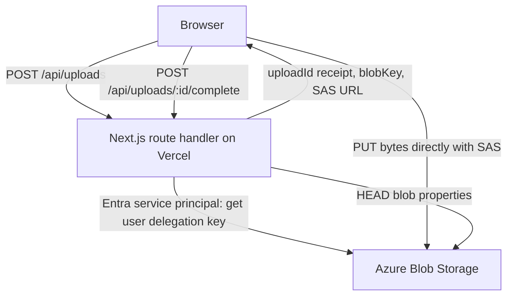

# Azure direct-to-Blob upload spike

The question this spike answers: can a Next.js browser app upload photos and
videos **straight to Azure Blob Storage** using short-lived, single-blob,
write-only **user delegation SAS** URLs, with no file bytes passing through
the app server?

The frontend and the small API are one **Next.js app** (`apps/web`). It deploys
to **Vercel**, and Azure only provides Blob Storage plus an Entra identity.

The original brief is in [docs/azure-direct-upload-spike.md](docs/azure-direct-upload-spike.md).
This build deliberately differs from it in three ways:

- **One Next.js app instead of a separate Fastify API.** The API lives in Next.js route handlers.
- **Vercel instead of Container Apps.** The server reaches Azure through a service principal, not a managed identity.
- **No auth on SAS issuance.** The brief asks for it; this spike relies on a same-origin check and a per-IP rate limit only.



Direct upload also gets around Vercel's ~4.5 MB request body limit for functions. Large videos couldn't go through the server anyway.

## Layout

```text
apps/web/
  app/api/uploads/                 POST: authorise and mint SAS
  app/api/uploads/[id]/complete/   POST: HEAD blob, check real size
  app/api/uploads/[id]/            DELETE: owner cleanup
  app/api/health/                  liveness; ?deep=1 checks the Azure identity
  app/_components/                 uploader UI + diagnostics panel
  lib/contracts.ts                 shared types and upload policies
  lib/server/                      env, signed receipts, storage, rate limit
  lib/client/                      fetch wrappers, browser Blob upload
infra/
  setup.sh                         az CLI provisioning
  README.md                        Azure settings, SAS scope, Vercel, delivery notes
```

## Running locally

1. Provision Azure (see [infra/README.md](infra/README.md)), or point at an existing account where your user has **Storage Blob Delegator** and **Storage Blob Data Contributor**.
2. `cp apps/web/.env.example apps/web/.env.local` and fill it in. Locally you can leave `AZURE_CLIENT_*` empty and run `az login`.
3. Start the dev server:

```bash
pnpm install
```

```bash
pnpm dev
```

Then open http://localhost:3000 and upload.

## How it works

**`POST /api/uploads`**
- **No auth.** Anyone who can reach the site can request an upload URL. The same-origin check and a per-IP rate limit are the only brakes, so turn on Vercel Deployment Protection if the URL gets shared widely.
- Rejects cross-origin requests (Origin header check).
- Checks the `uploadType` allowlist. The browser's `size` and `contentType` are **hints**, so they only gate obviously bad requests (422).
- Rate limit per IP, in memory per instance. On serverless that's a speed bump; use Redis or a WAF for anything real.
- The blob name is generated server-side as `<type>/<uuid>.<ext>`. The extension comes from the allowlisted MIME type, never from the filename.
- Mints a user delegation SAS (`sr=b`, `sp=cw`, `spr=https`, short TTL). The delegation key is cached for about 6 hours.
- Returns `uploadId`, which is an HMAC-signed receipt `{blob, maxBytes, exp}`. That lets `complete` work across serverless instances without a database.

**Browser**
- Checks size and type locally first for fast feedback.
- Requests one SAS per file. Up to 3 files upload at once.
- Uploads with `@azure/storage-blob` (`BlockBlobClient.uploadData`). Files up to 8 MiB go as a single Put Blob. Larger files go as parallel 8 MiB blocks plus Put Block List, with progress. `If-None-Match: *` blocks overwrites.
- On a 403 from Azure (for example an expired SAS) it requests a fresh SAS and retries once automatically. There's also a manual retry button.
- Shows the blob key and timings. The SAS URL is never shown or logged.

**`POST /api/uploads/:id/complete`**
- Checks the receipt signature, then reads blob properties. It never downloads content.
- Missing blob: 404. Empty or larger than the limit: deletes the blob, then 422.
- The stored `contentType` is client-supplied metadata, **not proof of format**. Nothing here certifies the file as safe.

## Test matrix

The **Diagnostics** panel in the UI runs these from the browser. "Expired SAS" and "bypassed size check" need `SPIKE_DEBUG_TOOLS=true`, which allows a short TTL and a smaller size limit for test requests.

| Scenario | Expected | How |
|---|---|---|
| Valid small JPEG | 201, then complete → accepted | Uploader / Diagnostics |
| Multiple photos | Independent progress and results | Uploader (select several) |
| Large video | Block upload succeeds within the 60 min SAS | Uploader |
| Oversized file picked in browser | Rejected immediately on the client | Uploader |
| Client size check bypassed | complete → 422 `blob_too_large`, blob deleted | Diagnostics (debug) |
| Expired SAS | Azure 403 | Diagnostics (debug) |
| Blob path altered | Azure 403 | Diagnostics |
| Blob URL without SAS | No anonymous read or write | Diagnostics, and `curl -i <blob-url>` |
| Overwrite an existing blob | Azure 409 | Diagnostics |
| complete before upload | 404 `blob_missing` | Diagnostics |
| Same file requested twice | Different blob keys | Diagnostics |
| SAS showing up in logs | Never logged; errors pass through `redact()` | Check Vercel function logs |
| Upload from another origin | Blocked by CORS (browser only) | Try from an origin that isn't in the list |

To confirm no bytes go through the server, open DevTools → Network during an
upload. The large `PUT` requests go to `<account>.blob.core.windows.net`.
`/api/*` requests are a few hundred bytes each.

## Not covered (deliberately)

No content inspection, malware scanning, entity creation, processing, polling or
WebSockets, and no user auth: anyone with the URL can upload. CORS is not
authentication. A short SAS expiry stops *new* requests; a request Azure has
already accepted can still finish. A real build must authenticate SAS issuance.
