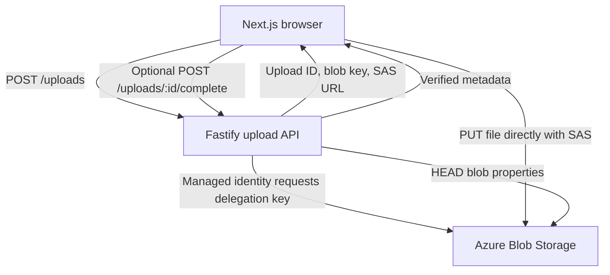

# Azure Direct-to-Blob Upload Spike

## Objective
Prove that a Next.js browser can upload photos and videos directly to Azure Blob Storage using short-lived, blob-scoped Shared Access Signature (SAS) URLs issued by a small Node.js service. No file bytes should transit the application server.

## Scope and success criteria
- Next.js page with a file picker, size/type feedback, progress, success and failure states.
- Node.js TypeScript API authenticates a test user, authorises an upload policy, and issues a SAS for a server-generated blob key.
- Browser PUTs file bytes directly to Blob Storage.
- Optional one-shot `complete` endpoint checks blob existence and actual byte length through Blob Storage properties; it never downloads the file.
- Demonstrate multiple concurrent uploads, expired tokens, unauthorised issuance, invalid type/size hints, and cleanup.
- Document the storage account/container name exposed in the SAS URL and the narrow permissions granted.
- Keep advanced media validation, malware scanning, entity creation, and processing out of the initial critical path.

## Suggested stack
- **Monorepo:** pnpm workspaces (Nx optional; not needed for this small spike).
- **Frontend:** Next.js, React, TypeScript.
- **Backend:** Node.js 22+ with TypeScript and Fastify.
- **Azure hosting:** Azure Static Web Apps or Azure App Service for the frontend; Azure Container Apps for the API (or App Service if simplicity wins).
- **Storage:** Azure Blob Storage, private upload container, CORS allowing the frontend origin; separate controlled delivery via Azure Front Door or an image transformation CDN.
- **Azure SDK:** `@azure/storage-blob` and `@azure/identity`.
- **Identity:** Managed identity in Azure; `DefaultAzureCredential` locally via Azure CLI. The browser never receives an account key.

## Repository structure
```text
azure-upload-spike/
  apps/
    web/                  # Next.js frontend
    upload-api/           # Fastify API
  packages/
    upload-contracts/     # shared TypeScript types, policies
  infra/
    README.md             # CLI/Bicep deployment steps
  pnpm-workspace.yaml
  package.json
  README.md
```

## Architecture


## API contract
### `POST /uploads`
Request:
```json
{ "uploadType": "photo", "filename": "example.jpg", "size": 123456, "contentType": "image/jpeg" }
```
Response:
```json
{ "uploadId": "generated-id", "blobKey": "incoming/generated-id", "uploadUrl": "https://...?...sas...", "expiresAt": "ISO-8601 timestamp", "requiredHeaders": { "x-ms-blob-type": "BlockBlob" } }
```
Notes:
- Use a server-side allowlist for `uploadType`, destination container, and permitted user roles.
- Authenticate the issuer endpoint. For a spike, use a documented test auth mechanism; never deploy an unrestricted public SAS minting endpoint.
- Generate unpredictable, non-overwriting blob names; do not trust user-supplied paths.
- Use a user delegation SAS scoped to one blob with the minimum permissions required for the selected upload method.
- Return SAS only over HTTPS and suppress SAS query strings in logs and telemetry.
- Size and MIME values supplied by the browser are **untrusted hints**.

### `POST /uploads/:id/complete` (optional)
Request: `{}`.
Response:
```json
{ "uploadId": "generated-id", "status": "accepted", "size": 123456, "contentType": "image/jpeg" }
```
- Resolve upload ID to a server-issued blob key (for the spike, a signed upload receipt or small short-lived store can work).
- Query Blob Storage properties to confirm existence and actual byte length.
- Treat Blob Storage content type as **client-supplied metadata**, not proof of format.
- Return a clear error if missing or oversized; optionally delete rejected uploads.
- This endpoint does not certify file contents as safe.

## Frontend behavior
1. Select one or more files using `<input type="file">` with a relevant `accept` hint.
2. Check `File.size` and `File.type` locally for fast user feedback.
3. Request one SAS per file from the API.
4. Upload directly to Blob Storage, displaying progress (XHR or Azure Blob SDK browser upload helpers).
5. Optionally call `complete` once per upload; show success only after its response if enabled.
6. Display returned blob key and upload timing; never print the SAS URL in the UI or console.
7. Retry by requesting a fresh SAS when needed; no polling or WebSockets.

## Storage security, delivery and tiering design

**Important distinction:** Publicly accessible images do not require the **storage account** or blob containers to allow anonymous reads. Prefer a private Blob origin with a controlled delivery layer. A public CDN URL and a private origin are compatible only if the CDN has an authorised way to fetch from the origin.

### Recommended topology
- **`incoming` private container:** Direct browser writes via blob-specific SAS; never anonymous reads. Validation or completion checks occur here.
- **`published` private container:** Only accepted content is copied/promoted here when the consuming workflow decides it can be published.
- **Azure Front Door Premium + Private Link origin (preferred test):** Configure Blob Storage as a private origin, approve its private endpoint connection, route public GET requests through Front Door, and block public network access to Blob Storage after validating that upload and backend access still work.
- **Third-party image-transforming CDN:** Verify whether it supports private Azure Blob origins using SAS, an authenticated origin fetch, or another supported mechanism. If it requires anonymously readable Blob URLs, it **cannot** simultaneously meet the goal of a fully private origin. Either accept a deliberately public read-only published container, introduce a secure origin gateway, or choose a CDN that supports private origins.
- A publicly accessible delivery URL does **not** imply a publicly writable storage account.

### Azure Storage account settings for the spike
| Setting | Recommended value / reason |
|---|---|
| Account type | Standard general-purpose v2 (StorageV2), Blob Storage |
| Performance | Standard, LRS for low-cost test (evaluate ZRS for production availability) |
| Anonymous blob access | **Disabled** at account level for the private-origin architecture |
| Container access | **Private** for `incoming` and `published` |
| Secure transfer required | Enabled (HTTPS only) |
| Minimum TLS | TLS 1.2 or higher where supported |
| Shared Key access | Disable if all workflows support Entra / user delegation SAS; this prevents account-key SAS and requires testing integrations |
| Public network access | Initially enabled with controlled access for browser-direct-upload proof; lock down later only with a tested network path |
| Blob versioning / soft delete | Optional for recovery, with short retention and cost awareness |
| CORS | Only exact Next.js origins, required methods and headers; not a security boundary |
| SAS | User delegation SAS generated by the Node API using its managed identity; one server-generated blob key, minimum permissions, short expiry |
| Logging | Exclude SAS query strings from logs, traces, analytics, and error reporting |
| Network firewall | Do not turn off public network access while expecting arbitrary browsers to PUT directly to the default Blob endpoint |

**Architectural constraint:** Fully disabling public network access on Blob Storage will also block ordinary browser-to-Blob SAS uploads over the public endpoint. SAS authorises requests but does not bypass network firewalls. To keep the origin fully private **and** preserve direct browser uploads, design a supported public upload ingress (for example a dedicated upload storage account with restricted SAS and private publication storage) or accept that the upload storage endpoint is publicly reachable but unauthorised requests are denied. The latter is a reasonable spike baseline and is not the same as anonymous read access.

### Smart tiering / automatic tiering
- Confirm which Azure Blob Storage automatic tiering capability is available for the chosen account type, region, and redundancy before enabling it; do not assume an AWS-style Intelligent-Tiering setting exists.
- For the spike, use **Azure Blob lifecycle management rules** to move older published blobs from Hot to Cool (and optionally Cold) based on last modification or access patterns as supported. Consider access tracking only if needed and account for its operational cost and limitations.
- Keep actively transformed media in Hot initially: retrieval fees, minimum retention charges, and rehydration constraints can make colder tiers counterproductive.
- Keep `incoming` staging objects Hot and add an expiration/deletion rule for abandoned uploads. Avoid automatically archiving content that must remain available for real-time CDN transformation.
- Validate tiering behavior separately from upload correctness; lifecycle actions are asynchronous.

### SAS minting permissions and identity
1. Enable system-assigned managed identity on the Node upload API (Azure Container Apps).
2. Grant it a role that includes `Microsoft.Storage/storageAccounts/blobServices/generateUserDelegationKey/action` at an appropriate account/resource-group scope, such as **Storage Blob Delegator**, and separately grant only the Blob data permissions needed for metadata checks and any optional promotion/deletion.
3. Use `DefaultAzureCredential` and `getUserDelegationKey` to generate a **user delegation SAS** for the exact target blob, not a container-wide SAS.
4. Authenticate and authorise calls to `POST /uploads` with your application's identity mechanism; the end user does not need Entra.
5. Avoid leaking SAS in logs and provide rate limits / quotas on token issuance.
6. Verify storage firewall rules and identity role assignments independently; neither replaces the other.

### Publish/read path
1. Upload to `incoming` using a short-lived write-only SAS.
2. The form records the logical upload reference; optionally verify blob existence/size with one completion request.
3. Once the relevant workflow authorises publication, move/copy to `published` or mark it published through a controlled service.
4. Expose a stable public CDN/Front Door URL for the approved asset; keep storage URLs and SAS out of persistent domain records where possible.
5. For transformations, verify origin authentication, caching, purge behavior, and whether the CDN needs to retrieve the original on cache miss.

## Azure setup
1. Create a resource group in a low-cost region.
2. Create a standard general-purpose v2 storage account and a **private** `incoming` blob container.
3. Disable anonymous blob access, require HTTPS, and configure Shared Key access according to the identity/SAS approach above.
4. Configure Blob service CORS for the deployed frontend origin and localhost development origin, allowing the required PUT/OPTIONS and headers.
5. Create a Container Apps environment and deploy the upload API with a managed identity.
6. Grant the API identity the necessary Blob data-plane permissions for checking/deleting blobs and **Storage Blob Delegator** (or an appropriate role containing `generateUserDelegationKey`) at the storage-account scope. Apply least privilege.
7. Configure the API with storage account name, container, allowed frontend origin, and policy configuration; avoid account keys.
8. Deploy the Next.js frontend and set its API base URL.
9. Confirm the storage network rules permit browser access to the Blob endpoint; public network reachability does not mean anonymous blob reads. Test Front Door Premium Private Link separately if using a private delivery origin.
10. Configure a lifecycle policy to remove abandoned blobs under `incoming/` after a short retention period, and optional Hot-to-Cool transitions for published blobs. Lifecycle deletion is not immediate validation.

## Implementation sequence
### Phase 1 — Local skeleton
- Initialise pnpm workspace, Next.js, Fastify, and shared types.
- Implement `/health`, `POST /uploads`, a simple file picker, and local validation.
- Use Azure CLI credentials locally to mint user delegation SAS.

### Phase 2 — Direct upload
- Add private container and CORS.
- Implement browser direct-to-Blob upload and progress.
- Verify network traces: bytes go from browser to `*.blob.core.windows.net`, not to Fastify.

### Phase 3 — Completion and resilience
- Implement optional completion HEAD/properties check.
- Test missing blob, oversized blob, interrupted upload, expired SAS, and repeated issuance.
- Add basic rate limits to issuance and avoid logging SAS tokens.

### Phase 4 — Azure deployment
- Deploy API to Container Apps using managed identity.
- Deploy frontend; configure origins and environment variables.
- Repeat tests against deployed services and inspect costs/metrics.

### Phase 5 — Findings
- Record latency, API memory/CPU, upload throughput, token issuance rate, Blob request costs, and developer experience.
- Document risk tradeoffs and whether to add asynchronous validation/processing later.

## Test matrix
| Scenario | Expected outcome |
|---|---|
| Valid small JPEG | Direct upload succeeds |
| Multiple photos | Independent progress and results |
| Large video | Upload succeeds within chosen token/transfer strategy |
| Browser-selected oversized file | Immediate client-side rejection |
| Bypassed client-side size check | Completion check rejects actual oversize |
| Expired SAS | Azure rejects new unauthorised requests; UI can request new URL |
| Altered blob path | SAS signature no longer authorises the request |
| Unauthenticated SAS issuance | API rejects |
| Blob URL without SAS | No anonymous read or write |
| SAS exposed in logging | No query string captured |
| Cross-origin upload | Only configured browser origins work under CORS policy |

## Explicit non-goals and caveats
- No WebSockets, status polling, or database-backed validation workflow.
- No file content inspection inside the API; optional metadata checks only.
- CORS is a browser control, **not** an authentication mechanism.
- A SAS URL exposes the account name, container and blob path; that is not by itself a grant of access. The SAS query string **is** a credential.
- A user delegation SAS uses the **service's** Entra identity; end users need not sign in to Entra.
- Short SAS expiry limits the time for new requests, not necessarily the duration of an already accepted request.
- Server-side enforcement of file format requires deeper content inspection or scanning; this spike intentionally does not claim to provide it.
- Use Azure budgets and alerts; delete the resource group when the spike ends. A free Azure account does not make all deployed resources free.
